# System architecture

This document describes the breathing rainbow firmware, PlatformIO build, and
HID upload path for the Robosapiens RSI-05 RBoard.

## Project and system diagram

```mermaid
flowchart LR
    subgraph Host[Fedora PC]
        IDE[VS Code + PlatformIO]
        PIO[platformio.ini\nArduino ATmega8, 12 MHz, C++11, -Os]
        Entry[src/main.cpp\nsetup and loop]
        Config[include/led_config.h\n21 active / 63 physical LEDs, D9/PB1]
        Effect[src/rainbow_breath.cpp\nRainbowBreath]
        Sine[64-entry sine table in flash]
        WsLibrary[light_ws2812 dependency]
        Build[ELF and Intel HEX build]
        Uploader[tools/bootloadHID\nHID uploader]
        IDE --> PIO --> Entry
        Entry --> Effect
        Config --> Effect
        Sine --> Effect
        Effect --> WsLibrary
        Entry --> Build
        Effect --> Build
        WsLibrary --> Build
        Udev[udev access for 16c0:05df] -. permits user access .-> Uploader
        Build --> Uploader
    end

    subgraph Board[Robosapiens RSI-05]
        USB[USB HID\nnot serial]
        Boot[BootloadHID bootloader]
        MCU[ATmega8 application]
        USB --> Boot -->|writes application HEX| MCU
    end
    Uploader -->|USB HID| USB

    subgraph LEDs[LED output]
        Breath[Rotating rainbow + eased breath\nfirst 21 pixels]
        Frame[63 x RGB frame\n189 bytes pixel data]
        DIN[WS2812 DIN]
        Strip[First 21 animated; remaining 42 black]
        Breath --> Frame -->|timed one-wire data| DIN --> Strip
        PSU[Regulated 5 V supply] --> Strip
    end
    MCU --> Breath
    MCU -. common ground .- Strip
```

## Build and upload

1. PlatformIO builds environment `atmega8` with the 12 MHz board clock and size
   optimization, producing an Intel HEX image within the 6144-byte app limit.
2. It compiles `src/main.cpp`, `src/rainbow_breath.cpp`, Arduino core,
   and pinned `light_ws2812` dependency.
3. The custom upload command runs `tools/bootloadHID -r "$SOURCE"`. The board
   enumerates as USB HID `16c0:05df`, not as a serial port.
4. The udev rule grants access to the logged-in user; BootloadHID writes the
   application HEX to the MCU.

## Runtime effect

1. Arduino startup initializes the MCU. `src/main.cpp` calls
   `RainbowBreath::begin()` once and services `update()` from `loop()`. The
   frame gate is 16 ms, targeting about 60 updates/s.
2. `include/led_config.h` selects the active LED count in a 63-pixel chain,
   Arduino D9/PB1, and a per-channel software ceiling of 16/255.
3. `rainbow_breath.cpp` evaluates an interpolated sine from flash to create a
   smooth global brightness pulse with a deep, nonzero trough for a clear visual
   breath. The full-strip hue gradient rotates independently of that cycle.
4. The renderer applies the effect to the configured active LEDs, writes black
   to the rest of the chain,
   then clamps each RGB channel to the configured ceiling before `sync()` sends
   the complete chain frame.

## Hardware and memory constraints

- **Power:** The software cap does not certify the board's current path. Use a
  separate regulated 5 V supply if the RBoard/USB path is not rated for the load,
  join grounds, and isolate external +5 V from PC USB +5 V.
- **Data:** Connect D9/PB1 through a 300–500 Ω series resistor to strip DIN.
  The resistor protects the signal input; it does not limit strip supply current.
- **RAM:** The framebuffer uses 189 bytes for 63 RGB pixels, plus allocator
  overhead and stack. Static firmware state is small; the ATmega8 has 1 KB SRAM.
- **Flash:** The application limit of 6144 bytes reserves the bootloader region.
